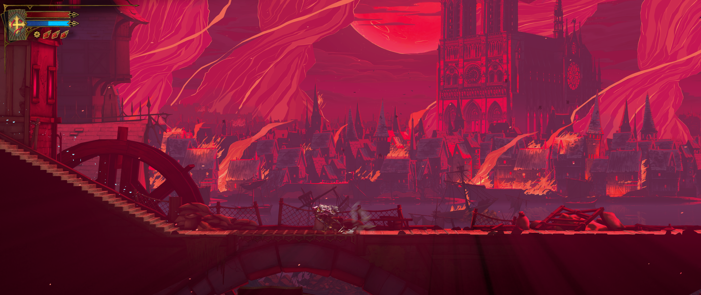

# Belmont's Curse Ultrawide

Ultrawide fixes for Castlevania: Belmont's Curse. Version 2.0 uses BepInEx and replaces the SUWSF version.

Uses your monitor resolution, including **3440×1440** and **5120×2160**, with proportional gameplay and UI that fits **1280×800 (16:10)** too. The HUD stays at the screen edges, while menus stay centered.

Includes the camera-boundary and locked-fight corrections, proportional area/world maps, Tarot clue layout, save-room mask removal, cutscene overlay removal and uncropped video presentation. The title-menu masks remain unchanged.

Checked locally at 5120×2160: gameplay, save rooms, map, Tarot hints, a scripted camera pan, a locked fight and the opening video. Both confiner hooks ran, and Mirror Fast Travel worked alongside the mod. A full boss fight and other aspect ratios still need playtesting with this version.



## Install

Download one ZIP from [Releases](https://github.com/ollieatkinson/castlevania-belmonts-curse-ultrawide/releases/latest):

- **`.standalone.zip`** includes BepInEx 6.0.788. Use this for a fresh install.
- **`.zip`** contains only the mod. Use this if you already have [BepInEx 6.0.788](https://www.nexusmods.com/castlevaniabelmontscurse/mods/3).

1. Close the game. If upgrading from our SUWSF version, remove `SUWSF.asi` and `SUWSF.ini`. Also remove `version.dll` and `version.ini` if they came from our old ZIP and no other ASI mods use them. Keep BepInEx and other mods.
2. Extract your chosen ZIP into the game directory, beside `Castlevania Belmont's Curse.exe`. The plugin goes in `BepInEx/plugins/`.
3. Launch, select **Fullscreen Windowed**, then select the **3840×2160** entry once. Its label stays the same, but it now uses your configured resolution.

The first launch with BepInEx may take a few minutes while it generates its game assemblies.

On Linux/Proton, BepInEx uses `WINEDLLOVERRIDES="winhttp=n,b" %command%`. Keep any other launch options you need.

`BepInEx/config/ollieatkinson.belmontscurseultrawide.cfg` defaults to `Resolution = auto`. To choose a resolution, use e.g. `Resolution = 3440x1440`. Restart after changing it. `Enabled = false` disables the fixes.

If you used a custom resolution in `SUWSF.ini`, copy that value into the new configuration file after the first launch.

Supports Steam build **25975867**. If the compatibility check rejects your game or a hook fails to install, the mod shows a warning and leaves the game running without the widescreen fixes. Details are in `BepInEx/LogOutput.log`.

## Remove

Close the game and delete `BepInEx/plugins/BelmontsCurseUltrawide.dll`. Its configuration file can also be deleted. Keep BepInEx if other mods use it. Game files and saves are unchanged.

## Build

Install the .NET 8 SDK and run BepInEx once to generate the game's interop assemblies. Build against that installation:

```sh
dotnet build -c Release -p:GamePath="/path/to/Castlevania Belmont's Curse"
```

The DLL is in `bin/Release/net6.0/`. To package it, use `dotnet msbuild -restore -t:Package -p:Configuration=Release -p:GamePath="/path/to/game"`. The ZIP in `dist/` contains the plugin, README and license.

Run `dotnet msbuild -t:PackageStandalone` afterward to make the second ZIP. It uses the plugin ZIP already in `dist/`, downloads the pinned BepInEx 788 distribution and source archives, and checks their SHA-256 hashes. To package an existing release, set `-p:PluginArchive="/path/to/release.zip"`. The standalone ZIP includes dependency licenses and corresponding sources. Neither ZIP includes game assemblies.

The **Standalone package** GitHub Actions workflow builds and uploads this ZIP for an existing release tag.

The source is in `src/`. Most fixes use Harmony. The two confiners use BepInEx native detours because version 6.0.788 cannot marshal their `ref CameraState` argument safely; methods are resolved through IL2CPP metadata, with no fixed game addresses or code caves. All hooks must install successfully.

See [Updating after a game update](doc/how-to-update.md).

MIT. Bundled dependencies retain their own licenses. Unofficial community fix.
