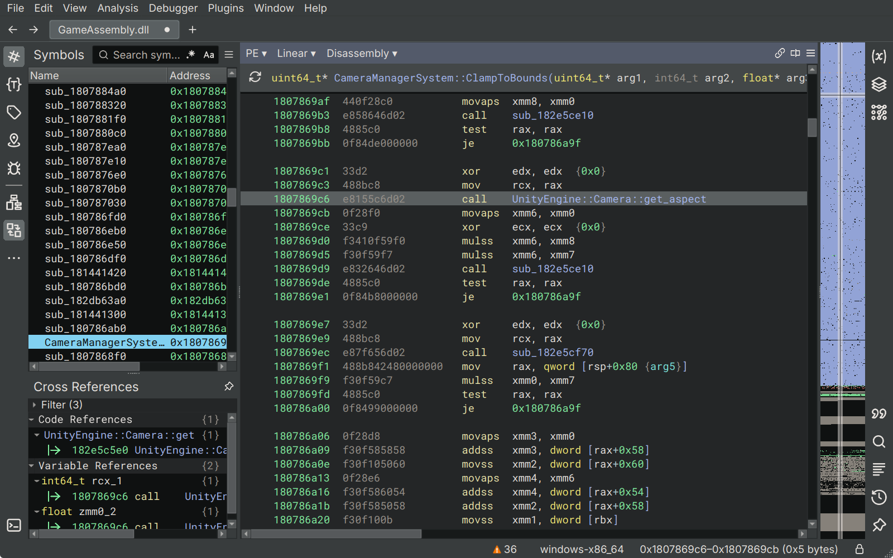

# Updating after a game update

Keep the old `GameAssembly.dll` and Binary Ninja database so you can compare them with the new version. Close the game and make a branch before starting.

Don't just change the compatibility hash: the patterns might still match while the addresses inside our hooks are wrong.

## Find the methods again

Open the new DLL in Binary Ninja alongside the old database. Run Il2CppDumper with the new DLL and its matching `global-metadata.dat` from the game's data folder (`il2cpp_data/Metadata`). Its `script.json` lists method names and addresses; `dump.cs` has signatures and field offsets.

Look up a method in `script.json`, press **G** in Binary Ninja and enter its address. Our current dump uses RVAs, so add the DLL's image base (`0x180000000`). Rename the function if it still has a `sub_…` name.

These are useful starting points; check the instructions and callers as well as the name:

| Fix | Where to look |
| --- | --- |
| Resolution presets and filter | `VideoSettings..cctor` and the predicate inside `UpdateSupportedResolutions` |
| UI scaling | `UnityEngine.UI.CanvasScaler.HandleScaleWithScreenSize` |
| Menu camera | `SwitchToWorldSpaceUi.<CoroutineToWorld>…MoveNext`, where it enables the camera |
| Camera boundaries | Both `CinemachineConfiner2DSimplified.PostPipelineStageCallback` and `Cinemachine.CinemachineConfiner2D.PostPipelineStageCallback` |
| Locked fights and bosses | `CameraManagerSystem.ClampToBounds` and `CameraScreenSize.get_screenRatio` |
| Maps | `UIMapLevelManager` and `UIMapWorldManager`: `WarmupRenderTexture`, `ApplyRenderTexture`, `ResizeRenderTexture` |
| Tarot clues | `HuntViewManager.UpdateDisplay`, which jumps to `GenerateListClueItems` |
| Save-room masks | `RoomManager.RoomManagerSystem.OnRoomChanged`, after `InvokeEventOnRoomChanged` |
| Cutscene bars | `MenuStackLayerUIContainer.OnPushLayer` |
| Videos | `VideoController.PlayVideo`, where it calls `UnityEngine.UI.RawImage.set_texture` |

For example, this is the call to `Camera.get_aspect` inside `ClampToBounds` in Steam build 25975867. We replace this call with our camera wrapper. Find the equivalent call in the new build, rather than copying its old address.

## Update the source

Update these together:

- **`src/menu-camera.ld`**: update every helper address and call/jump site using Binary Ninja's virtual addresses. Check the `il2cpp_string_new` export too. In the example, `.ArenaCameraCall` is the call site and `get_aspect` is its original target.
- **`src/SUWSF.ini.in`**: refresh each `Pattern` and `Offset` to find the intended instruction. Check every match against the untouched DLL: currently two per resolution patch and one for everything else. Don't loosen patterns just to make them match.
- **`src/*.s`**: check arguments, field offsets and replaced instructions. The Tarot and video fixes also rely on the scene layout.

The hooks live in unused executable padding. Check that it's still unused, mapped and large enough. If a hook moves, update its linker address and the corresponding `00…` INI patch. The linker checks for overlaps between our hooks, but can't tell whether the game now uses that space.

## Build and check

Run `cmake -S . -B build`, then `cmake --build build --target package`. Inspect `build/menu-camera.elf` with `objdump -d`: calls and jumps must reach the new addresses, and replacements must cover whole instructions. Edit the template, not the generated `build/SUWSF.ini`.

After checking the code, update the build-number comment and `[Compatibility] SHA256` using `sha256sum` on the new DLL, then rebuild. Keep `Atomic=true` and the expected match counts enabled.

Install the generated INI with the guarded SUWSF loader and launch the game. Check `SUWSF.log` for rejected patches. Try movement, a locked fight or boss, a save room, both maps, Tarot clues and a pre-rendered video. Check 16:10, 21:9 and 32:9 where possible.

Note the supported Steam build and what you've checked before releasing.
